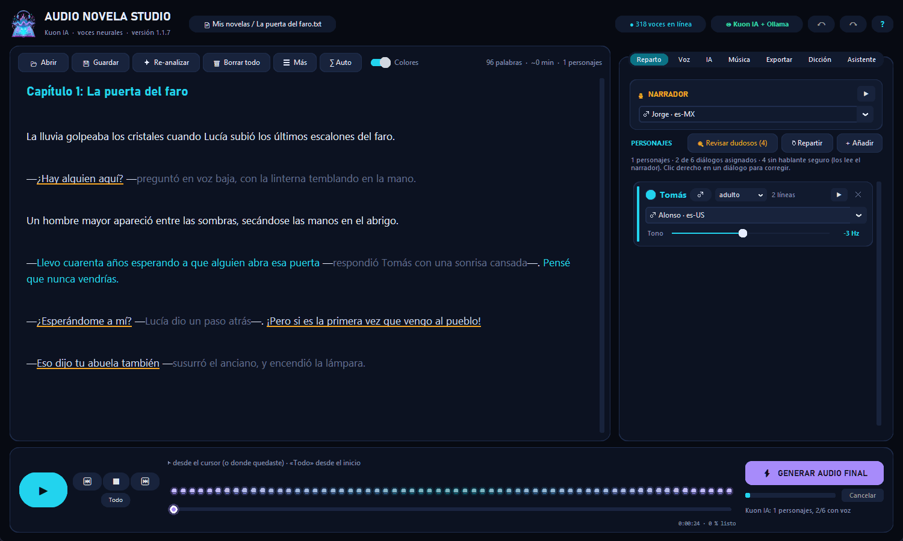
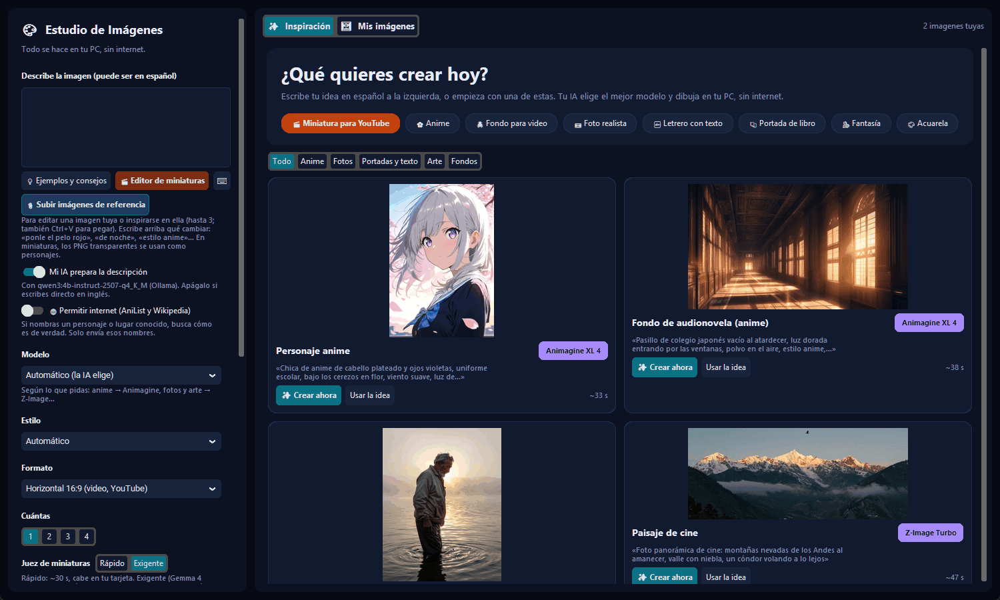
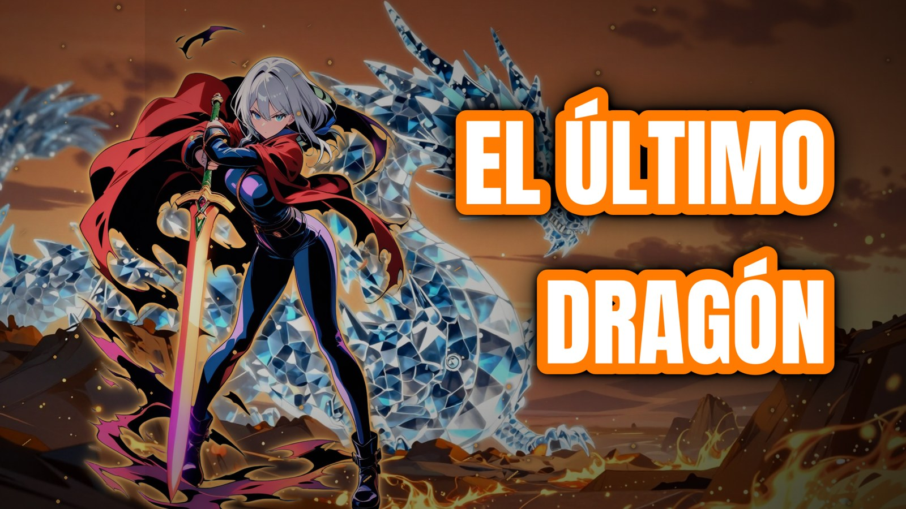
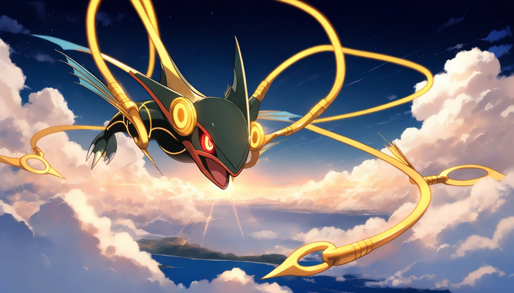
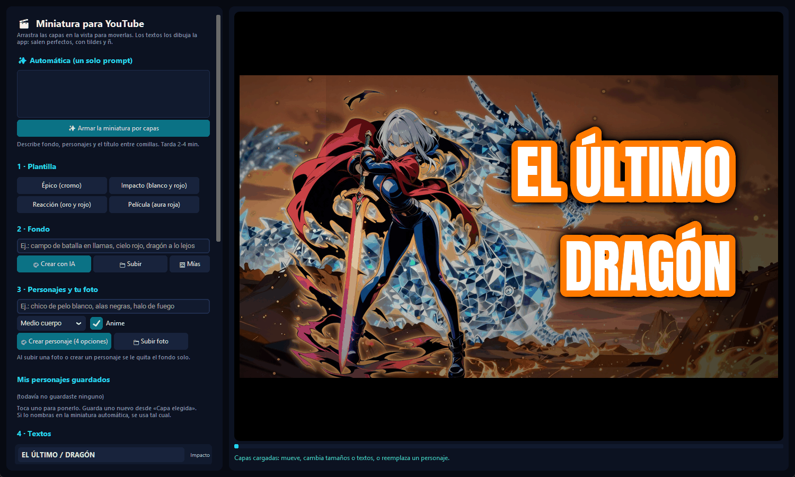

# Audio Novela Studio + Estudio de Imágenes

**Convierte tus novelas y fanfics en audiolibros con varias voces, y crea imágenes y miniaturas de YouTube con IA,
todo en tu PC con Windows.** Hecho en español, para gente que escribe y narra en español.

### [⬇️ Descargar para Windows y Android](https://github.com/jyuniorjp/AudioNovelaStudio/releases/latest)

## 🎧 Audio Novela Studio
Pega o abre tu historia y escúchala narrada al instante, con una voz para el narrador y otra para cada personaje.

- **Kuon IA** encuentra los diálogos y quién habla, y le da a cada personaje su voz (mujer, hombre, niño, anciano…).
- **Emociones:** cada frase se lee con su tono (grito, susurro, miedo, ternura, enojo…).
- **Acentos:** latino neutro, México, Colombia, Perú, rioplatense, Chile, España y otros idiomas (318 voces).
- **Dicción:** te avisa de nombres que una voz leería raro y eliges cómo pronunciarlos.
- **Lee de todo:** TXT, DOCX, ODT, RTF, EPUB, FB2, HTML, PDF (también escaneados, con OCR) y subtítulos.
- **Exporta** audio y **video** con subtítulos y fondos que la IA dibuja para cada capítulo.
- Clic derecho en un diálogo para corregir quién habla: Kuon IA aprende de cada corrección.

## 🎨 Estudio de Imágenes
Describe en español lo que quieres y tu PC lo dibuja, sin internet y sin pagar por imagen.

- **Elige el modelo solo:** anime y personajes conocidos (Pokémon, Genshin…) → Animagine XL 4;
  fotos, arte y texto → Z-Image Turbo. También puedes elegirlo tú.
- **Revisa su trabajo:** una IA que ve (Gemma 4) comprueba que la imagen tenga lo que pediste y la repite si falta algo.
- **Miniaturas de YouTube en un paso:** fondo, personajes recortados sin bordes y el título con letras perfectas,
  donde y como lo pidas («a la derecha, blancas con borde naranja»). Hace 3 versiones y recomienda la mejor.
- **Editor de miniaturas** por capas, con plantillas, personajes guardados y atajos (Ctrl+Z, flechas, Supr…).
- Edita tus imágenes (hasta 3 de referencia o pega con Ctrl+V), amplía 2x/4x, quita fondos y guarda en cualquier formato.

| Miniatura hecha con un solo prompt | Personaje conocido (Mega Rayquaza shiny) |
|---|---|
|  |  |

## Cómo probarlo
1. Descarga los instaladores desde [Releases](https://github.com/jyuniorjp/AudioNovelaStudio/releases/latest).
2. Ábrelos. No piden permisos de administrador. Si Windows dice «Windows protegió tu PC», pulsa
   **Más información → Ejecutar de todas formas** (pasa con programas nuevos sin firma de pago).
3. **Android:** descarga `AudioNovelaStudio_1.1.7_Android.apk` en el teléfono, ábrela y permite «instalar apps
   de origen desconocido» si te lo pide.
4. **Audio Novela Studio** funciona enseguida (voces en línea gratis; voces sin internet opcionales).
5. **Estudio de Imágenes:** la primera vez te muestra qué descarga (motor y modelos), cuánto pesa y para qué
   sirve cada parte, y lo instala con un botón.

### Requisitos
- Windows 10 u 11 de 64 bits.
- Para las imágenes: tarjeta **NVIDIA** de 4 GB o más (mejor 6 GB), controlador 580 o más nuevo, 16 GB de RAM
  y unos 20 GB libres. Opcional: [Ollama](https://ollama.com) para la IA que prepara y revisa los pedidos
  (el Estudio lo instala si quieres).

## Compilar desde el código
1. Python 3.12+ y un entorno `.venv` con `pip install -r requirements.txt`.
2. `COMPILAR.bat` crea `AudioNovelaStudio.exe` y su instalador (Inno Setup 6).
3. `COMPILAR_IMAGENES.bat` crea `EstudioImagenes.exe` y su instalador.

## Qué no está en este repositorio
- El código de la versión de Android (la app sí está para descargar en Releases).
- Modelos grandes de terceros: la voz neuronal Piper `es_MX-claude-high`
  ([HirCoir/Piper-TTS-Spanish](https://huggingface.co/spaces/HirCoir/Piper-TTS-Spanish), Apache-2.0) va en `voz/`.

El Estudio de Imágenes también está solo en [jyuniorjp/EstudioImagenes](https://github.com/jyuniorjp/EstudioImagenes).
Más detalles de uso en [LEEME.txt](LEEME.txt) y [LEEME_IMAGENES.txt](LEEME_IMAGENES.txt).

## Licencia
MIT: puedes usar, copiar y modificar este código mientras mantengas el aviso de autor. Ver [LICENSE](LICENSE).
Las fuentes de `fuentes/` usan la licencia SIL OFL 1.1.
